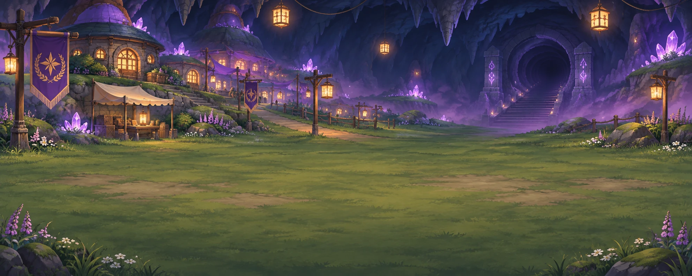

# Dungeon Team Manager



**A companion app for a Pokémon Mystery Dungeon–style tabletop campaign.**
The Dungeon Master runs the world, battles and loot from one screen. Each player follows along on their own phone and acts on their Pokémon's turn.

**▶ Try it: [dennis-lclema.github.io/dungeon-team-manager](https://dennis-lclema.github.io/dungeon-team-manager/)**

> *Five hundred years ago, Pokémon fled a war with the humans into the Labyrinth. Thirty years ago, the Great Calamity sealed every gate and split families apart. Now the Explorers' Guild sends its youngest graduates down to open them again.*

---

## Features

**For players**
- 📱 A **Play** screen that shows what's happening right now, and buzzes when it's your turn
- 🎲 **Hit and miss popups** with the roll, the damage and type effectiveness, on every screen at once
- 🎯 **Roll your own dice**: type your d20 and damage roll, and the app adds your bonuses
- 🎲 **Rolled stats**: six scores are rolled when a Pokémon is made (4d6, drop the lowest); its player places them once and they lock for good
- 🎭 **Personality quiz**: 8 questions give a nature (a small stat boost) and a demeanor to roleplay. An "in character" card shows it whenever the team meets someone, and the DM rewards good roleplay with Inspiration
- 🧬 Character sheets with moves, PP, a 3-branch skill tree, held items, evolution and Mega Trials
- ✨ **Preset abilities** that work in battle (Sturdy, Flash Fire, Prankster…), plus an **ability maker**: pick what your own ability does (a status, a heal, a power-up or a shield), the DM approves it, and you trigger it with one tap in battle

**For the Dungeon Master**
- 🗺️ **9 overworld layers** and a **40-floor Labyrinth**, with a Shadow Gatekeeper every 5 floors
- ⚔️ Turn-based battles with initiative, ambushes, Shadow Pokémon and purification
- 🌫️ **Creative moments**: turn a clever idea (Fire on Water makes a Steam Fog) into a field effect for a few rounds
- 🔥 **Status conditions**: burn, poison, paralysis, sleep, freeze and confusion run automatically each turn
- 🎲 **Everything rolls itself**: every status move (stat changes, heals, Protect, cures and the rest), status chances on attacks (Ember's burn), saves and assists need no bookkeeping
- 🎬 **Battle scene**: a d20 tumbles and lands for every roll, attacks fly across the scene, damage numbers float up, and built-in sound effects play (🔔 in the top bar turns them off)
- 🎯 **Real dice, if the table wants them**: the DM switches on "Players roll real dice", players roll at the table, and the DM types the numbers in
- 🌳 **Write your own skill-tree entries**: a player rewrites an entry and picks a bonus (+1 to hit, +4 max HP…); once the DM approves it, the app applies it
- ⚔️🛡️ **Weapons and armor** in their own slots, alongside a held item
- 🥊 A one-tap **graduation spar** against the rival team, each rival hunting the player it chose
- 📜 **Previously on…**: a recap of last session's highlights, shown on everyone's screen
- 🎲 **Ability checks** (STR, DEX, CON, INT, WIS, CHA) from the sheet, and **status moves that resolve themselves** with a save against the DC
- ↩ **Undo** for the DM, and **automatic backups** of the whole game on the DM's device (last 3 days)
- 📱 **Installs like an app**: on a phone, open the site and choose *Add to Home Screen* (iPhone: Share menu; Android: ⋮ menu)
- 💰 Loot rolls with suggestions for who should get each item, shops, **Charisma haggling** and quests
- 🧑‍🤝‍🧑 A story cast: village guildmasters, a rival team, a medical corps, and a mysterious trickster. Players see characters once they've met them, and a friendship meter changes prices and help
- 🖼️ Painted battle backgrounds for every layer, Labyrinth descent and Red Rift, plus pixel sprites for 1,200+ Pokémon
- 🎵 Scene-based music: drop MP3s in `public/music/` (see the README there)

---

## Play it

| Where | Shared team? | Best for |
|---|---|---|
| **Claude link** | ✅ Everyone shares one live team | Groups where everyone has a Claude account |
| **GitHub Pages** | ✅ Everyone with the same **game code** shares one live team (through Firebase) | Anyone with a browser |

**Joining a game on GitHub Pages:** tap the DM's **invite link** (Admin → Invite players → Copy invite link), or open the site and type the **game code** in the *Join your game* box. Then log in. Codes are 8–40 letters, numbers or dashes. Anyone with the site and the code can join, so keep the code within your group. Without a code, the team stays on that one device.

The shared database is Google Firebase (project settings in `src/game/firebase.ts`, access rules in `firestore.rules`).

Log in with your name. The default password is your name in lowercase (for example `luis`), until you change it.

---

## Run it on your computer

You need [Node.js](https://nodejs.org) 20 or newer.

```bash
npm install
npm run dev
```

| Command | What it does |
|---|---|
| `npm run dev` | Starts the app at http://localhost:5173 |
| `npm test` | Runs the rules tests (battles, abilities, haggling, field effects…) |
| `npm run lint` | Checks the code |
| `npm run build` | Builds the site into `dist/` |
| `node scripts/fetch-sprites.mjs` | Re-downloads the pixel sprites from PokéAPI |

## Host it on GitHub Pages

1. Push this folder to the `main` branch of a GitHub repository.
2. In the repository, open **Settings → Pages** and set **Source** to **GitHub Actions**.
3. Every push to `main` lints, tests, builds and deploys the site automatically.
   It appears at `https://<your-username>.github.io/<repository-name>/`.

---

## For the DM

- [STORY.md](STORY.md): the world, the cast and Chapter 1, beat by beat ⚠️ *spoilers*
- [LABYRINTH.md](LABYRINTH.md): lore for each of the 8 Labyrinth descents
- [BACKGROUNDS.md](BACKGROUNDS.md): what each battle background shows, and the file names

## How the code is organised

```
src/
  game/        rules engine, battles, world and dungeon, story cast, save and sync (no React)
  components/  shared pieces: avatars, popups, shop, music player
  views/       one file per tab (Team, World, Dungeon, Battle, DM tools…)
public/
  backgrounds/ battle backgrounds (WebP)
  music/       background music slots (MP3)
  dex.json, dexinfo.json, sprites.json   Pokédex data and pixel sprites
```

Built with React, TypeScript and Vite. Every change to the game goes through `update()` in `src/game/store.ts`.

---

## Credits

- Pokémon data and pixel sprites from [PokéAPI](https://pokeapi.co).
- Pokémon and all related names are © Nintendo, Game Freak and The Pokémon Company. This is a free, non-commercial fan project for a private tabletop group, not affiliated with or endorsed by them.
